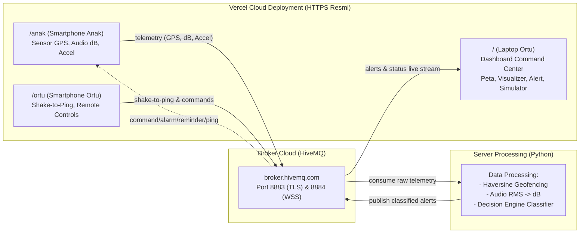

# 🛡️ RantauGuard (isDugem)
### Smart Student & Parental Guardian System — IoT Multicommunication 2 Arah & Multisensor

[](#)
[](#)
[](#)
[](#)

RantauGuard adalah sistem IoT pemantau mahasiswa rantau terintegrasi dengan validasi **multisensor** (GPS + Mikrofon Suasana Sekitar + Akselerometer) dan **komunikasi dua arah** berbasis protokol MQTT. Sistem ini mampu mendeteksi manipulasi lokasi (*Fake GPS*) melalui verifikasi silang antara koordinat klaim dengan intensitas kebisingan suara ruangan.

---

## 📌 Daftar Isi
1. [Arsitektur & Alur Sistem](#-arsitektur--alur-sistem)
2. [Pembagian Tugas Tim (3 Orang)](#-pembagian-tugas-tim-3-orang)
3. [Alur Kerja Git & Kolaborasi Tim (Wajib Dipatuhi)](#-alur-kerja-git--kolaborasi-tim-wajib-dipatuhi)
4. [Struktur Folder Monorepo](#-struktur-folder-monorepo)
5. [Panduan Menjalankan Modul (Quickstart)](#-panduan-menjalankan-modul-quickstart)
6. [Kontrak Komunikasi & Broker MQTT](#-kontrak-komunikasi--broker-mqtt)
7. [Checklist Skenario Demo](#-checklist-skenario-demo)

---

## 🏗️ Arsitektur & Alur Sistem



---

## 🌐 Arsitektur Deployment Baru (All-in-One Vercel HTTPS)

Untuk menghindari kendala **pemblokiran izin mikrofon & GPS oleh browser smartphone (Chrome & Safari)** pada jaringan lokal non-HTTPS, seluruh modul antarmuka web disatukan dalam **1 Project Next.js di Vercel**:

- **Domain Vercel:** `https://isdugem.vercel.app` (contoh)
- 💻 **Laptop Ortu (Dashboard):** buka `https://isdugem.vercel.app/`
- 📱 **HP Anak (Sensor):** buka `https://isdugem.vercel.app/anak` (scan QR Code)
- 📱 **HP Ortu (Shake-to-Ping):** buka `https://isdugem.vercel.app/ortu` (scan QR Code)

> ✅ **Keunggulan:**
> 1. Bebas dari kendala WiFi kampus (*tidak wajib 1 jaringan WiFi yang sama*).
> 2. Izin GPS & Mikrofon otomatis disetujui karena menggunakan protokol **HTTPS terenkripsi resmi**.
> 3. Desain antarmuka 100% konsisten menggunakan Tailwind CSS.

---

## 👥 Pembagian Tugas Tim (3 Orang)

Setiap anggota memiliki area tanggung jawab masing-masing untuk mencegah tabrakan kode (*merge conflict*):

| Anggota | Peran | Folder Tanggung Jawab | Prefix Branch |
|---|---|---|---|
| **Anggota 1** | **Edge Device Lead** | `dashboard/app/anak/`, `dashboard/app/ortu/` *(fallback: `edge/`)* | `edge/*` |
| **Anggota 2** | **Backend Processing & Algoritma Lead** | `server/` | `server/*` |
| **Anggota 3** | **Dashboard Lead (Next.js)** | `dashboard/app/page.tsx`, `dashboard/components/` | `dashboard/*` |

---

## 🌿 Alur Kerja Git & Kolaborasi Tim (Wajib Dipatuhi)

Untuk memastikan proyek selesai rapi, terintegrasi, dan tidak ada file yang rusak menjelang deadline, ikuti aturan Git berikut:

### 1. Struktur Cabang (Branching Model)
- `main` : Cabang stabil (*production ready*). **Dilarang langsung push ke `main`**. Cabang ini hanya di-merge dari `develop` saat rilis demo final.
- `develop` : Cabang integrasi utama. Tempat seluruh fitur tim digabungkan dan diuji bersama.
- Cabang Fitur Pribadi : Dibuat bercabang dari `develop` dengan prefix nama modul masing-masing.

### 2. Standar Nama Branch
- Modul Edge: `edge/anak-baca-gps`, `edge/ortu-shake-detect`
- Modul Server: `server/formula-haversine`, `server/decision-engine`
- Modul Dashboard: `dashboard/map-leaflet`, `dashboard/command-center`

### 3. Standar Pesan Commit (Conventional Commits)
Gunakan format: `<tipe>(<modul>): <deskripsi singkat>`
- `feat(edge-anak): tambah pembacaan mic web audio api`
- `fix(server): perbaiki pembagian nol pada audio rms`
- `feat(dashboard): integrasi websocket mqtt ke status card`
- `test(server): tambah unit test untuk kondisi anomaly fake gps`
- `docs(readme): perbarui langkah instalasi lokal`

---

### 4. Langkah Step-by-Step Mengerjakan Fitur (Panduan untuk Teman Tim)

#### Langkah 1: Clone dan Sinkronisasi Awal
```bash
git clone https://github.com/chulopp/isDugem.git
cd isDugem

# Pindah ke branch integrasi develop
git checkout develop
git pull origin develop
```

#### Langkah 2: Buat Branch Fitur Baru
```bash
# Contoh untuk Anggota 1 yang mengerjakan sensor anak:
git checkout -b edge/anak-sensor-capture

# Contoh untuk Anggota 2 yang mengerjakan server:
git checkout -b server/koneksi-mqtt-processing
```

#### Langkah 3: Kerjakan Fitur & Uji Secara Mandiri
> ⚠️ **PENTING:** Kerjakan kode **HANYA** di folder modul Anda sendiri (`edge/`, `server/`, atau `dashboard/`). Jangan mengedit file di folder modul rekan Anda kecuali telah disepakati bersama.

#### Langkah 4: Commit dan Push ke GitHub
```bash
# Periksa file yang diubah
git status

# Tambahkan perubahan dan commit
git add .
git commit -m "feat(edge-anak): implementasi pengiriman payload telemetri"

# Push branch fitur ke GitHub
git push -u origin edge/anak-sensor-capture
```

#### Langkah 5: Buka Pull Request (PR) ke `develop`
1. Buka repository di browser: [https://github.com/chulopp/isDugem](https://github.com/chulopp/isDugem)
2. Klik tombol **"Compare & pull request"**.
3. **PENTING:** Pastikan arah merge:
   - `base: develop` ⬅️ `compare: branch-fitur-anda`
   - *(JANGAN jadikan base ke `main`!)*
4. Isi checklist pada template PR yang otomatis muncul:
   - [x] Kontrak data MQTT cocok dengan `docs/mqtt-schema.md`
   - [x] Tidak ada `.env` yang ter-commit
   - [x] Sudah diuji secara mandiri
5. Minta minimal **1 rekan kelompok** untuk melakukan *Review & Approve*.
6. Setelah di-approve, branch dapat di-merge ke `develop`.

---

## 📁 Struktur Folder Monorepo

```
isDugem/
├── .github/
│   └── PULL_REQUEST_TEMPLATE.md       # Template PR otomatis dengan checklist kontrak
├── .gitignore                         # Mengabaikan file env, venv, cache, node_modules
├── .env.example                       # Referensi variabel lingkungan global
├── README.md                          # Panduan tim utama
├── docs/
│   ├── prd.md                         # Product Requirement Document (PRD v2)
│   ├── mqtt-schema.md                 # KONTRAK DATA: Topik, Payload JSON, POI, Enum
│   └── demo-script.md                 # Skenario pengujian & langkah demonstrasi kelas
├── edge/                              # Tanggung jawab: Anggota 1
│   ├── anak/                          # Web app sensor HP anak (GPS, Audio dB, Accel)
│   └── ortu/                          # Web app HP ortu (Shake-to-ping & remote)
├── server/                            # Tanggung jawab: Anggota 2
│   ├── requirements.txt               # paho-mqtt, python-dotenv, pytest
│   ├── config.py                      # Loader environment & koordinat POI
│   ├── models.py                      # Dataclass Telemetry, Context, Alert
│   ├── mqtt_client.py                 # Klien MQTT HiveMQ TLS
│   ├── main.py                        # Server main loop (Subscribe -> Process -> Publish)
│   ├── processing/                    # Algoritma: Haversine, Audio RMS, Decision Engine
│   └── tests/                         # Unit tests pytest (16 tests lulus)
└── dashboard/                         # Tanggung jawab: Anggota 3
    ├── .env.local.example             # Konfigurasi Next.js WebSocket
    └── README.md                      # Petunjuk setup & arsitektur UI Next.js
```

---

## 🚀 Panduan Menjalankan Modul (Quickstart)

### 1. Modul Server Backend Python (`server/`)
1. Masuk ke folder server dan aktifkan *virtual environment* yang sudah terpasang dependensinya:
   ```bash
   cd server

   # Gunakan virtual environment yang sudah tersedia di proyek (.venv315):
   source .venv315/bin/activate       # Linux/Mac
   # atau di Windows PowerShell jika dibuat manual:
   # .\.venv315\Scripts\Activate.ps1

   # ATAU jika menyiapkan virtual environment baru dari awal:
   # python3 -m venv .venv315 && source .venv315/bin/activate
   # pip install -r requirements.txt
   ```
   > ⚠️ **Penting:** Jalankan server selalu di dalam virtual environment (`.venv315`), bukan dengan Python global sistem, karena seluruh pustaka seperti `paho-mqtt` dan `python-dotenv` terpasang di dalamnya.
2. Jalankan pengujian unit test (verifikasi logika internal):
   ```bash
   pytest
   ```
   *(Memverifikasi seluruh 155 unit test backend lulus hijau).*
3. Jalankan server:
   ```bash
   python main.py
   ```

---

### 2. Modul Web App & Dashboard Next.js (`dashboard/`)
Seluruh antarmuka web (Dashboard Laptop `/`, HP Anak `/anak`, dan HP Ortu `/ortu`) dikelola di dalam folder ini:

1. Masuk ke folder dashboard dan pasang dependensi:
   ```bash
   cd dashboard
   cp .env.local.example .env.local
   npm install
   ```
2. Jalankan server pengembang di lokal:
   ```bash
   npm run dev
   ```
   - Dashboard Laptop: [http://localhost:3000](http://localhost:3000)
   - Web HP Anak: [http://localhost:3000/anak](http://localhost:3000/anak)
   - Web HP Ortu: [http://localhost:3000/ortu](http://localhost:3000/ortu)

   > ⚠️ **Catatan Akses Smartphone (HTTP vs HTTPS):**
   > - Akses peramban laptop via `http://localhost:3000` diperlakukan sebagai *Secure Context*, sehingga seluruh visualisasi dan panel simulasi preset berjalan penuh.
   > - Jika smartphone mengakses alamat IP lokal non-localhost via HTTP biasa (misal `http://192.168.x.x:3000/anak`), peramban mobile (Chrome Android/Safari iOS) akan **memblokir izin mikrofon dan GPS**.
   > - Untuk presentasi kelas, disarankan menggunakan **Demo Preset Panel** langsung di laptop (`localhost:3000`). Jika ingin menghubungkan smartphone fisik, gunakan deployment HTTPS resmi (seperti Vercel) atau tunnel HTTPS (seperti Ngrok/Cloudflare Tunnel).

3. **Deploy ke Vercel (Produksi HTTPS Gratis):**
   - Connect repository `chulopp/isDugem` ke akun [Vercel](https://vercel.com).
   - Set *Root Directory* ke: `dashboard`.
   - Klik **Deploy** ➔ Dapatkan domain `https://<nama-project>.vercel.app`.
   - HP Anak dan HP Ortu tinggal memindai QR Code dari browser smartphone masing-masing.

---

### 3. Modul Edge Standalone Fallback (`edge/anak/` & `edge/ortu/`)
*Tersedia sebagai cadangan file statis HTML/JS jika ingin dijalankan tanpa Next.js / saat pengujian offline.*
1. Salin konfigurasi:
   ```bash
   cd edge/anak && cp config.example.js config.js
   cd ../ortu && cp config.example.js config.js
   ```
2. Buka menggunakan extension **Live Server** di VS Code atau server lokal statis.

---

## 📡 Kontrak Komunikasi & Broker MQTT

> ⚠️ **PERHATIAN KERAS KEPADA SELURUH ANGGOTA:**
> Jangan pernah mengubah nama field JSON atau nama topik MQTT tanpa memperbarui dokumen `docs/mqtt-schema.md`! Ketiga modul saling bergantung pada kontrak ini.

- **Broker Publik:** `broker.hivemq.com`
- **Port Edge & Server:** `8883` (MQTTS over TLS)
- **Port Dashboard:** `8884` (MQTT over Secure WebSocket: `wss://broker.hivemq.com:8884/mqtt`)
- **Prefix Topik (`PROJECT_ID`):** `isdugem_tim_01` (dapat disesuaikan di `.env`)

Dokumentasi lengkap payload dapat dibaca di:
👉 **[docs/mqtt-schema.md](docs/mqtt-schema.md)**

---

## 🎬 Checklist Skenario Demo & Status Verifikasi

Status kesiapan skenario berdasarkan hasil pengujian aktual:
- [x] **Unit Testing Logika & Model Data:** 155 pengujian Pytest backend dan 4 pengujian Vitest dashboard lulus 100% (menguji formula Haversine, desibel audio, validasi payload, dan fusi tabel keputusan).
- [x] **Skenario Terdeteksi di Bar (Terverifikasi End-to-End Real UI):** Terbukti secara nyata melalui klik tombol preset pada UI peramban $\rightarrow$ MQTT WSS $\rightarrow$ HiveMQ TLS $\rightarrow$ Server Backend $\rightarrow$ publikasi alert $\rightarrow$ subscriber dashboard $\rightarrow$ status `CRITICAL_TERDETEKSI_DI_BAR` tampil pada kartu dan banner visual dashboard.
- [x] **Skenario Terverifikasi Logika & Simulasi Server:**
  - **Skenario Normal Kuliah:** Status `SEDANG_KULIAH` aktif saat lokasi di kampus dengan audio tenang (< 65 dB).
  - **Skenario Bolos Kuliah:** Status `ALERT_BOLOS_KULIAH` aktif saat lokasi menjauh pada jam kuliah (> 150 m).
  - **Skenario Pengingat Sholat:** Status `WARNING_BELUM_KE_MASJID` dan tombol reminder mengirim pesan pengingat.
  - **Skenario Anomali Fake GPS (Andalan):** Status `ANOMALY_FAKE_GPS` aktif saat koordinat berada di kos tetapi mikrofon mendeteksi suara dentuman > 80 dB.
  - **Komunikasi 2 Arah:** Goyangkan HP Ortu (*shake*) atau tekan tombol remote memicu perintah ke topik `command/*`.

Skrip lengkap pengujian dapat dibaca di:
👉 **[docs/demo-script.md](docs/demo-script.md)**
