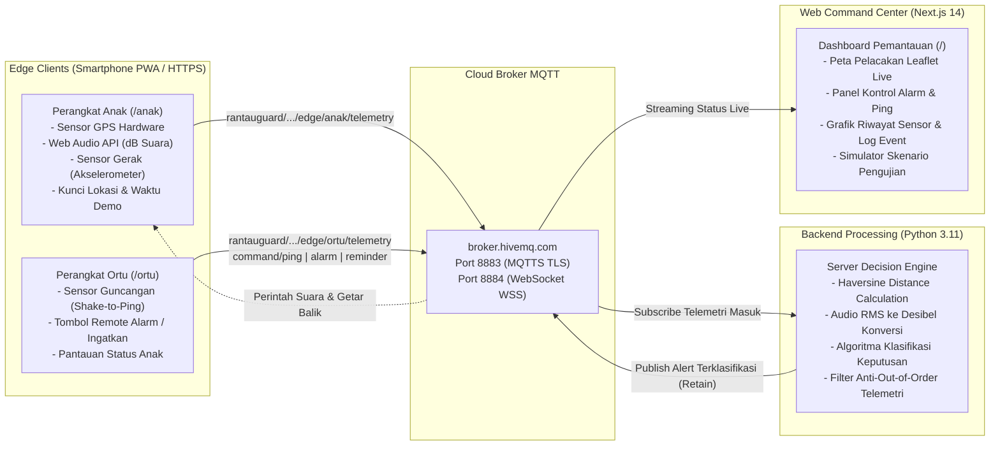

<p align="center">
  
</p>

<h1 align="center">isDugem</h1>

<p align="center">
  <b>IoT Smart Student Guardian & Parental Monitoring System</b><br>
  <i>Sistem Pemantauan Cerdas Mahasiswa Rantau Berbasis IoT Multisensor dan Komunikasi Dua Arah</i>
</p>

<p align="center">
  <a href="#"></a>
  <a href="#"></a>
  <a href="#"></a>
  <a href="#"></a>
  <a href="#"></a>
</p>

---

## 1. Ringkasan Eksekutif & Latar Belakang

Mahasiswa yang menjalani perkuliahan jauh dari keluarga (mahasiswa rantau) menghadapi berbagai tantangan kemandirian, mulai dari kedisiplinan jadwal akademik hingga potensi pengaruh pergaulan malam berisiko. Di sisi lain, orang tua memiliki keterbatasan akses untuk memantau keselamatan dan aktivitas anak secara objektif.

Aplikasi pemantau lokasi konvensional memiliki kelemahan mendasar: **rentan terhadap manipulasi lokasi (*Fake GPS*)** dan tidak memiliki konteks aktivitas nyata.

**isDugem** hadir sebagai solusi berbasis *Internet of Things* (IoT) yang menggabungkan:
1. **Validasi Multisensor:** Memadukan sensor lokasi (GPS), sensor kebisingan suara sekitar (*Web Audio API* untuk membaca desibel), dan sensor gerak (*DeviceMotionEvent* / akselerometer).
2. **Verifikasi Silang (*Cross-Verification*):** Mendeteksi indikasi *Fake GPS* ketika koordinat anak diklaim berada di kos, namun tingkat kebisingan mikrofon terdeteksi tinggi pada jam malam.
3. **Komunikasi Dua Arah (*Bidirectional MQTT*):** Memungkinkan orang tua melakukan *remote control* darurat seperti memicu dering alarm, mengirim pengingat, atau memeriksa posisi anak melalui gestur menggoyangkan ponsel (*shake-to-ping*).

---

## 2. Fitur Utama Sistem

- **Geofencing & Verifikasi Silang Anti-Fake GPS:**
  Sistem mengevaluasi jarak anak terhadap titik-titik penting (Kampus UNDIP, Masjid, area kos, dan zona hiburan malam Kota Lama). Jika terdeteksi klaim lokasi di kos pada jam malam tetapi mikrofon menangkap kebisingan klub (> 80 dB), sistem otomatis menetapkan status **ANOMALI FAKE GPS**.

- **Klasifikasi Kontekstual Berbasis Waktu:**
  Evaluasi status berjalan dinamis mengikuti jendela waktu: Jam Kuliah (08:00 - 15:00 WIB), Waktu Sholat (Dzuhur, Ashar, Maghrib, Isya), Jam Malam (22:00 - 05:00 WIB), dan Jam Normal/Santai.

- **Sensor Gerak Shake-to-Ping:**
  Orang tua cukup menggoyangkan ponsel (*akselerasi > 18 m/s²*) untuk langsung mengirim sinyal periksa lokasi (*ping*) secara instan ke perangkat anak.

- **Kontrol Perintah Jarak Jauh (Remote Command):**
  Orang tua dan operator dashboard dapat membunyikan sirine alarm darurat, mengirim teks pengingat belajar/ibadah, atau meminta pembaruan telemetri terkini.

- **Peta Pelacakan Interaktif & Visualisasi Audio:**
  Dashboard menyajikan peta pelacakan langsung (*Leaflet*), rute navigasi jalan (*OSRM integration*), indikator tingkat suara langsung (*dB level*), kecepatan gerak, dan riwayat kejadian tercatat.

- **Sinkronisasi Demo Dua Arah Real-Time:**
  Tersedia fitur kunci koordinat demo dan kunci waktu demo di HP Anak maupun Dashboard laptop untuk mempermudah simulasi berbagai skenario pengujian tanpa jeda (*zero latency*).

---

## 3. Arsitektur Sistem & Aliran Data

Sistem dirancang dengan arsitektur terdistribusi yang memisahkan antara antarmuka pengguna, pemrosesan sensor di sisi klien (*Edge*), perantara pesan terenkripsi (*Cloud Broker*), dan mesin pengambil keputusan (*Backend Decision Engine*).



### Penjelasan Komponen Arsitektur:
1. **Perangkat Anak (`/anak`):**
   Aplikasi web mobile yang membaca sensor perangkat keras secara langsung (Geolocation, mikrofon, akselerometer) dan mempublikasikan data telemetri terstruktur setiap detik ke broker MQTT.
2. **Perangkat Orang Tua (`/ortu`):**
   Aplikasi web mobile untuk orang tua yang menampilkan status terkini anak dan mendeteksi gestur guncangan fisik untuk mengirim perintah *ping*.
3. **Dashboard Pemantauan (`/`):**
   Pusat kendali berbasis Next.js 14 yang menampilkan visualisasi data terpadu, pemetaan geografis, grafik tren kebisingan, dan panel kendali sistem.
4. **Server Decision Engine (`server/`):**
   Layanan Python independen yang melakukan perhitungan matematis jarak Haversine terhadap titik-titik POI, mengonversi sinyal audio RMS ke skala desibel, dan mengklasifikasikan status keamanan mahasiswa rantau.

---

## 4. Matriks Logika Keputusan (Decision Engine Matrix)

Mesin keputusan (*decision engine*) mengevaluasi status berdasarkan irisan antara waktu lokal (WIB), jarak terhadap koordinat *Point of Interest* (POI), dan tingkat intensitas kebisingan mikrofon:

| Konteks Waktu | Syarat Jarak POI | Syarat Suara (dB) | Status Keputusan | Deskripsi Status |
|---|---|---|---|---|
| **Jam Kuliah**<br>(08:00 - 15:00 WIB) | Jarak ke Kampus <= 150 m | Suara tenang (< 65 dB) | `SEDANG_KULIAH` | Mahasiswa berada di area kampus dalam suasana kelas kondusif. |
| **Jam Kuliah**<br>(08:00 - 15:00 WIB) | Jarak ke Kampus > 150 m | Bebas | `ALERT_BOLOS_KULIAH` | Mahasiswa berada di luar area kampus saat jam perkuliahan berlangsung. |
| **Waktu Sholat**<br>(Jadwal Sholat Wajib) | Jarak ke Masjid > 100 m | Bebas | `WARNING_BELUM_KE_MASJID` | Pengingat waktu sholat aktif saat mahasiswa berada jauh dari masjid kampus. |
| **Jam Malam**<br>(22:00 - 05:00 WIB) | Jarak ke Kos <= 750 m | Suara tenang (< 55 dB) | `ISTIRAHAT_DI_KOS` | Mahasiswa berada di area kos dalam keadaan tenang dan beristirahat. |
| **Jam Malam**<br>(22:00 - 05:00 WIB) | Jarak ke Kos <= 750 m (Klaim) | Suara bising (> 80 dB) | `ANOMALY_FAKE_GPS` | Terdeteksi indikasi manipulasi lokasi: klaim GPS di kos tetapi audio menangkap kebisingan tinggi. |
| **Jam Malam**<br>(22:00 - 05:00 WIB) | Jarak ke Bar <= 250 m | Suara bising (> 75 dB) | `CRITICAL_TERDETEKSI_DI_BAR` | Mahasiswa terdeteksi berada di lokasi hiburan malam pada jam rawan. |
| **Semua Waktu** | Di luar kondisi batas | Sesuai kondisi | `NORMAL` | Aktivitas harian normal di luar parameter anomali risiko. |

---

## 5. Protokol Komunikasi & Kontrak Data MQTT

Seluruh komunikasi antar-entitas menggunakan standar pertukaran pesan MQTT terenkripsi melalui HiveMQ Cloud:
- **Broker Host:** `broker.hivemq.com`
- **Port Komunikasi:** `8883` (MQTTS over TLS untuk Python Server) dan `8884` (WSS over TLS untuk Web Dashboard/PWA).
- **Format Pertukaran:** JSON Payload standar.

### Struktur Topik MQTT:
```
rantauguard/{PROJECT_ID}/
├── edge/anak/telemetry       # Paket data sensor lokasi, dB audio, akselerometer anak
├── edge/ortu/telemetry       # Paket data status guncangan (shake) dari orang tua
├── alerts                    # Keputusan resmi hasil evaluasi backend (retained)
├── command/ping              # Perintah periksa lokasi anak
├── command/alarm             # Perintah memicu sirine darurat pada HP anak
├── command/reminder          # Perintah kirim notifikasi pengingat ke HP anak
└── command/timemode          # Sinkronisasi simulasi waktu dan kunci lokasi demo
```

### Contoh Payload Telemetri (`edge/anak/telemetry`):
```json
{
  "device_id": "anak",
  "sequence": 14205,
  "sent_at_ms": 1793160000000,
  "location": {
    "lat": -7.067588,
    "lon": 110.439708,
    "accuracy_m": 5.0
  },
  "audio": {
    "rms": 0.0028,
    "db": 48.9
  },
  "motion": {
    "accel_magnitude": 9.8
  }
}
```

---

## 6. Akses Sistem & Panduan Demonstrasi

Seluruh antarmuka web sistem isDugem telah di-deploy secara publik menggunakan protokol **HTTPS resmi di Vercel** sehingga dapat langsung diakses melalui peramban laptop maupun smartphone:

- **Dashboard Pemantauan (Laptop):** [https://isdugem.vercel.app](https://isdugem.vercel.app)
- **Antarmuka Sensor HP Anak:** [https://isdugem.vercel.app/anak](https://isdugem.vercel.app/anak)
- **Antarmuka Remote HP Orang Tua:** [https://isdugem.vercel.app/ortu](https://isdugem.vercel.app/ortu)

### Langkah Demonstrasi Pengujian Sistem (3 Menit):
1. **Jalankan Server Keputusan di Komputer Penguji:**
   ```bash
   cd server
   python main.py
   ```
   > **Catatan Eksekusi Server (Lingkungan Python):**
   > - **Eksekusi Langsung:** Server dapat langsung dijalankan dengan perintah `python main.py` tanpa mewajibkan virtual environment (`venv`), asalkan pustaka pendukung (`paho-mqtt` dan `python-dotenv`) sudah terpasang di Python komputer Anda.
   > - **Instalasi pada Komputer Baru (Opsional):** Jika dijalankan pada komputer penguji atau laptop lain yang belum memiliki dependensi, jalankan:
   >   ```bash
   >   pip install -r requirements.txt
   >   ```
   > - **Penggunaan Virtual Environment (Opsional):** Penggunaan `venv` bersifat opsional (praktik terbaik jika ingin mengisolasi dependensi agar tidak bercampur dengan proyek Python lain):
   >   ```bash
   >   python -m venv venv
   >   # Windows:
   >   .\venv\Scripts\activate
   >   # Linux/Mac:
   >   source venv/bin/activate
   >   pip install -r requirements.txt
   >   ```
2. **Buka Aplikasi pada 2 Ponsel dan 1 Laptop:**
   - Buka `/anak` pada HP pertama (klik **Mulai Sensor & Telemetri**).
   - Buka `/ortu` pada HP kedua (klik **Aktifkan Sensor Shake-to-Ping**).
   - Buka halaman utama `/` pada laptop sebagai dashboard pemantau.
3. **Uji Skenario Anomali Fake GPS:**
   - Pada HP Anak, tekan **Kunci di Kos Mulawarman** dan pilih **Simulasi Jam Malam (23:00 WIB)**.
   - Perhatikan status awal: sistem membaca kondisi tenang sebagai **ISTIRAHAT DI KOS**.
   - Tiup atau buat suara bising di dekat mikrofon HP Anak (> 80 dB): dalam waktu kurang dari 0,3 detik, status di Dashboard dan HP Ortu langsung berubah menjadi **ANOMALI FAKE GPS**.
4. **Uji Komunikasi Dua Arah Shake-to-Ping:**
   - Goyangkan HP Orang Tua: sensor akselerometer mendeteksi guncangan (> 18 m/s²) dan otomatis memicu perintah *ping* ke HP Anak secara langsung.

---

## 7. Hasil Pengujian & Verifikasi Kinerja

Kualitas dan keandalan sistem telah divalidasi melalui pengujian bertingkat:

- **Pengujian Unit Backend (Pytest):**
  Sebanyak **169 skenario pengujian unit** telah dijalankan dan lulus 100%, meliputi verifikasi rumus Haversine geofence, konversi logaritma RMS audio, validasi payload JSON, toleransi out-of-order paket telemetri, serta seluruh percabangan mesin klasifikasi keputusan.
- **Pengujian Kompilasi Frontend (Next.js Production Build):**
  Seluruh komponen antarmuka, peta Leaflet, dan modul hooks MQTT lulus uji validasi tipe TypeScript dan kompilasi statis tanpa galat (*zero error*).
- **Pengujian Multiperangkat Fisik Secara Nyata:**
  Telah diuji menggunakan kombinasi laptop dan 2 smartphone fisik (iOS dan Android) yang terhubung ke jaringan seluler berbeda tanpa hambatan izin sensor berkat dukungan penuh HTTPS.

---

## 8. Teknologi yang Digunakan (Tech Stack)

### Antarmuka & Frontend
- **Next.js 14 (App Router)** - Framework React performa tinggi untuk antarmuka web dan mobile PWA.
- **TypeScript** - Menjamin keamanan tipe data dan keandalan kode aplikasi.
- **Tailwind CSS** - Tata letak modern, bersih, responsif, dan konsisten di semua ukuran layar.
- **Leaflet & React-Leaflet** - Mesin rendering peta interaktif berbasis OpenStreetMap.
- **Lucide Icons** - Pustaka ikon grafis vektor profesional.

### Backend & Pemrosesan Data
- **Python 3.11** - Bahasa utama pemrosesan algoritma keputusan dan pemodelan matematis.
- **Paho-MQTT** - Klien MQTT bersertifikasi untuk komunikasi jaringan IoT.
- **Pytest** - Kerangka kerja pengujian otomatis (*automated testing*).

### Jaringan & Komunikasi Data
- **HiveMQ Cloud Broker** - Broker pesan MQTT enterprise berkinerja tinggi.
- **MQTTS (TLS v1.3 / Port 8883)** - Protokol komunikasi terenkripsi aman untuk klien Python.
- **WebSocket Secure (WSS / Port 8884)** - Protokol streaming telemetri real-time untuk peramban web.

---

## 9. Tim Pengembang

Proyek **isDugem** dikembangkan oleh:

| Nama Lengkap | NIM | Peran & Tanggung Jawab Kontribusi |
|---|---|---|
| **Fallah Iqbal Kurnianto** | `24060125130065` | **Pengembang Dashboard**<br>Arsitektur UI/UX Dashboard Next.js, integrasi peta Leaflet, visualisasi data audio & grafik riwayat, panel kontrol simulasi preset, dan tata kelola deployment Vercel. |
| **Raditya Arganta Anantio** | `24060125120021` | **Pengembang Backend & Algoritma**<br>Perancangan Server Decision Engine Python, implementasi formula jarak Haversine, konversi RMS desibel, pengujian unit Pytest (169 skenario), dan arsitektur topik MQTT. |
| **Wendi Adi Ardiansah** | `24060125120027` | **Pengembang Edge Device**<br>Pengembangan modul web sensor HP Anak (Web Audio API desibel, Geolocation API, akselerometer), modul remote HP Orang Tua (Shake-to-Ping), dan optimasi latensi telemetri. |

---

<p align="center">
  <b>Departemen Ilmu Komputer / Informatika</b><br>
  Universitas Diponegoro &bull; 2026
</p>
